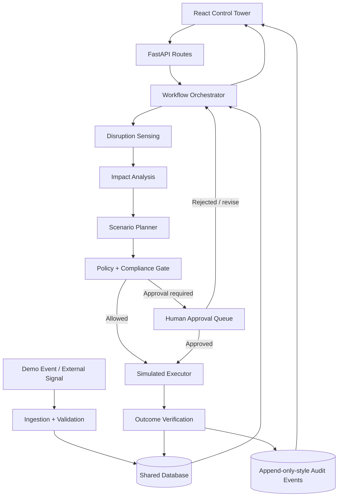

# 01 — Architecture and Component Boundaries

## Architecture choice

Use a **modular monolith plus a workflow orchestrator** for the hackathon. Keep modules separated by responsibility, but deploy one FastAPI backend and one frontend. This minimises integration and deployment overhead while leaving a path to separate services later.

## Layers

### Presentation layer — Member 5
- Incident list and incident detail.
- Impact summary and scenario comparison.
- Approval queue / decision form.
- Audit timeline and before/after outcome.
- Loading, retry, validation, empty, and error states.

### API and orchestration — Member 1
- FastAPI app and router registration.
- Workflow lifecycle and status transitions.
- Shared Pydantic types and persistence conventions.
- Correlation IDs, error format, health check, dependency injection.
- Integration of module routers into the app.

### Analysis and planning — Members 2 and 3
- Member 2: event normalization, evidence, classification, impact map, stock coverage, at-risk orders.
- Member 3: candidate plans, deterministic cost/lead-time/shortage metrics, feasibility, transparent ranking.

### Governance and action — Member 4
- Policy checks, approval request creation, approve/reject handling.
- Simulated shipment/procurement/inventory action.
- Idempotency, audit entries, post-action verification.

### Infrastructure boundary
- `adapters/event_source/`: demo JSON now; optional approved external feeds later.
- `adapters/sap/`: mock SAP read/write adapter now; actual SAP connectivity only when enabled and credentials/access are supplied.
- `repositories/`: persistence details; business logic must not embed SQL queries.
- `llm/`: optional provider adapter. Do not let a model make hard policy decisions.

## Request flow

1. `POST /api/disruptions` creates an incident and returns `202` or `201` with an `incident_id`.
2. Workflow is started through `POST /api/incidents/{id}/analyze` (or a background worker if the implementation needs it; synchronous is acceptable for the demo).
3. The orchestrator moves through detection confirmation, impact, option generation, and policy evaluation.
4. The final response reports the current state and scenario IDs; a risky selected option opens an approval request.
5. Approval endpoint changes approval state. Only then can an execution service apply the simulated plan.
6. Verification recalculates availability/ETA and appends an audit record.

## Important design choices

- **Synchronous first:** don't introduce a queue unless the actual workload requires it. Keep workflow functions independently testable.
- **Typed contracts:** Pydantic models at module boundaries; no free-form paragraph as an API response.
- **Single source of truth:** shared domain records and the workflow's persisted status. UI state must not be treated as authority.
- **Determinism:** calculations and hard policy rules must be repeatable. LLM outputs may enrich text, but any extracted values must be validated against schemas and evidence.
- **No hidden actions:** every proposed/attempted/completed action has a decision ID, actor, status, timestamp, and reason.
